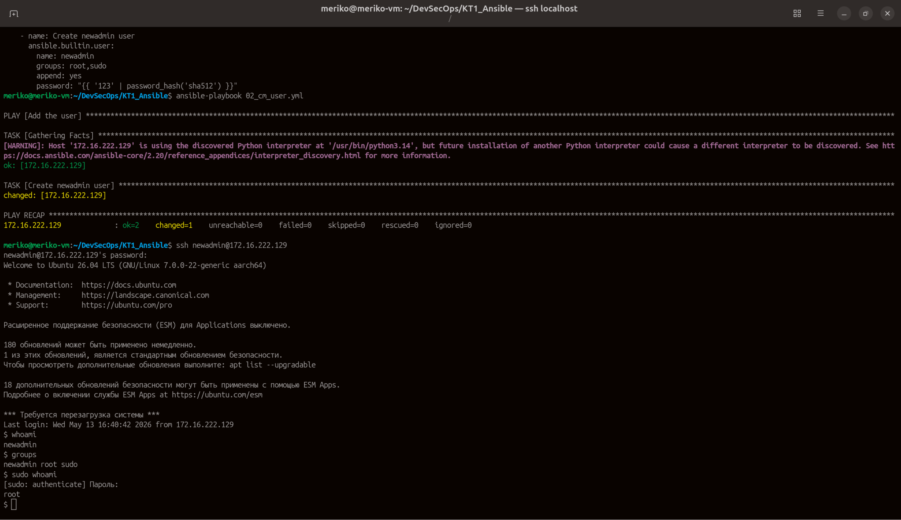

# КТ-1. Ansible Playbooks

## 1. Установка и настройка Nginx

**Файл:** `01_nginx_install.yml`

**Роль:** `roles/nginx/tasks/main.yml`

**Переменные:** `group_vars/NGINX`

### Назначение

Автоматическая установка веб-сервера Nginx на целевой сервер с помощью Ansible.

### Выполненные действия

1. Установка пакета Nginx с помощью модуля `apt`.
2. Запуск службы Nginx с помощью модуля `service`.
3. Включение автоматического запуска Nginx при загрузке системы.

### Запуск

```bash
ansible-playbook 01_nginx_install.yml
```

### Проверка

Проверка состояния службы:

```bash
systemctl status nginx
```

Проверка HTTP-ответа:

```bash
curl -I http://localhost
```


### Результат

Nginx успешно установлен, запущен и добавлен в автозагрузку. Проверка HTTP-запросом вернула `HTTP/1.1 200 OK`.


## 2. Создание пользователя и назначение прав

**Файл:** `02_cm_user.yml`

### Назначение

Автоматическое создание пользователя `newadmin` на целевом сервере и предоставление ему административных прав.

### Выполненные действия

1. Создание пользователя `newadmin` с помощью модуля `user`.
2. Добавление пользователя в группы `root` и `sudo`.
3. Сохранение существующих дополнительных групп с помощью параметра `append`.
4. Установка пароля с использованием хеширования SHA-512.

### Запуск

```bash
ansible-playbook 02_cm_user.yml
```

### Проверка

Подключение к серверу:

```bash
ssh newadmin@172.16.222.129
```

Проверка имени пользователя:

```bash
whoami
```

Проверка групп:

```bash
groups
```

Проверка административных прав:

```bash
sudo whoami
```



### Результат

Пользователь `newadmin` успешно создан. Подключение по SSH работает, пользователь входит в группы `root` и `sudo`. Выполнение команды `sudo whoami` возвращает `root`, что подтверждает наличие административных прав.
