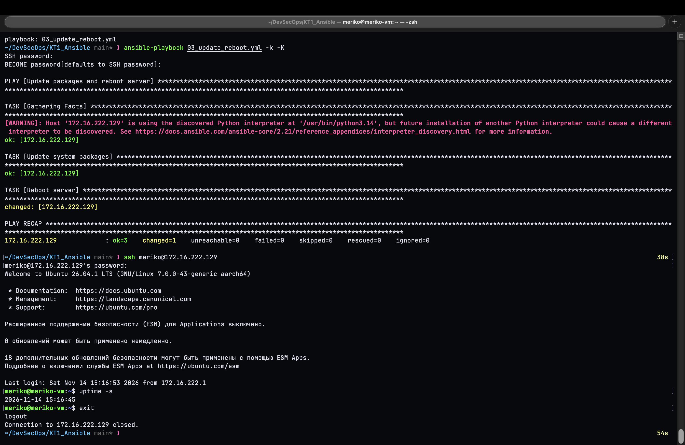

# КТ-1. Ansible Playbooks

## 1. Установка и настройка Nginx

**Файл:** `01_nginx_install.yml`

**Роль:** `roles/nginx/tasks/main.yml`

**Переменные:** `group_vars/NGINX`

### Назначение

Автоматическая установка веб-сервера Nginx на целевой сервер с помощью Ansible.

### Выполненные действия

1. Установка пакета Nginx с помощью модуля `apt`.
2. Запуск службы Nginx с помощью модуля `service`.
3. Включение автоматического запуска Nginx при загрузке системы.

### Запуск

```bash
ansible-playbook 01_nginx_install.yml
```

### Проверка

Проверка состояния службы:

```bash
systemctl status nginx
```

Проверка HTTP-ответа:

```bash
curl -I http://localhost
```


### Результат

Nginx успешно установлен, запущен и добавлен в автозагрузку. Проверка HTTP-запросом вернула `HTTP/1.1 200 OK`.


## 2. Создание пользователя и назначение прав

**Файл:** `02_cm_user.yml`

### Назначение

Автоматическое создание пользователя `newadmin` на целевом сервере и предоставление ему административных прав.

### Выполненные действия

1. Создание пользователя `newadmin` с помощью модуля `user`.
2. Добавление пользователя в группы `root` и `sudo`.
3. Сохранение существующих дополнительных групп с помощью параметра `append`.
4. Установка пароля с использованием хеширования SHA-512.

### Запуск

```bash
ansible-playbook 02_cm_user.yml
```

### Проверка

Подключение к серверу:

```bash
ssh newadmin@172.16.222.129
```

Проверка имени пользователя:

```bash
whoami
```

Проверка групп:

```bash
groups
```

Проверка административных прав:

```bash
sudo whoami
```


### Результат

Пользователь `newadmin` успешно создан. Подключение по SSH работает, пользователь входит в группы `root` и `sudo`. Выполнение команды `sudo whoami` возвращает `root`, что подтверждает наличие административных прав.


## Задание 3. Обновление пакетов и перезагрузка сервера

### Цель
Разработать Ansible Playbook для обновления установленных пакетов на целевом сервере и последующей перезагрузки системы.

### Реализация
Создан Playbook `03_update_reboot.yml`.

Используемые модули:
- `ansible.builtin.apt` — обновление списка пакетов и установка доступных обновлений.
- `ansible.builtin.reboot` — перезагрузка сервера и ожидание его доступности.

### Запуск

Проверка синтаксиса:

```bash
ansible-playbook 03_update_reboot.yml --syntax-check
```

Запуск:

```bash
ansible-playbook 03_update_reboot.yml -k -K
```

### Результат выполнения

Playbook успешно обновил пакеты и перезагрузил целевой сервер.

Итог выполнения:

- `ok=3`
- `changed=1`
- `unreachable=0`
- `failed=0`

### Проверка результата

Проверка времени последней загрузки:

```bash
uptime -s
```


Результат: `2026-11-14 15:16:45`.

После перезагрузки SSH-подключение к серверу восстановилось.

### Вывод
Обновление пакетов и перезагрузка целевого сервера успешно автоматизированы с помощью Ansible. Работоспособность сервера после перезагрузки подтверждена повторным SSH-подключением.


## Задание 4. Резервное копирование конфигурационных файлов

### Цель
Разработать Ansible Playbook для создания резервных копий конфигурационных файлов на целевом сервере.

### Реализация
Создан Playbook `04_backup_configs.yml`.

Использованные модули:
- `ansible.builtin.file` — создание каталога для резервных копий и настройка его прав доступа.
- `ansible.builtin.copy` — копирование конфигурационных файлов.

Выполнены следующие действия:
1. Создан каталог `/opt/config-backups`.
2. Назначены владелец и группа `root`.
3. Установлены права доступа `0700`.
4. Создана резервная копия `/etc/ssh/sshd_config`.
5. Создана резервная копия `/etc/nginx/nginx.conf`.

Для копирования использован параметр `remote_src: true`, поскольку исходные файлы находятся непосредственно на целевом сервере.

### Проверка и запуск

Проверка синтаксиса:

```bash
ansible-playbook 04_backup_configs.yml --syntax-check
```

Запуск:

```bash
ansible-playbook 04_backup_configs.yml -k -K
```

Результат выполнения:

- `ok=4`
- `changed=3`
- `unreachable=0`
- `failed=0`

### Проверка результата

Проверка содержимого каталога:

```bash
sudo ls -a /opt/config-backups/
```

Результат:
- `sshd_config`
- `nginx.conf`

Проверка количества строк:

```bash
sudo wc -l /opt/config-backups/sshd_config /opt/config-backups/nginx.conf
```


Результат:
- `sshd_config` — 145 строк.
- `nginx.conf` — 84 строки.
- Всего — 229 строк.

Проверка доступа без `sudo` завершилась с `Permission denied`, что соответствует установленным правам `0700`.

### Вывод

Playbook успешно выполнен. Резервные копии обоих конфигурационных файлов созданы на целевом сервере, наличие содержимого подтверждено проверкой.
