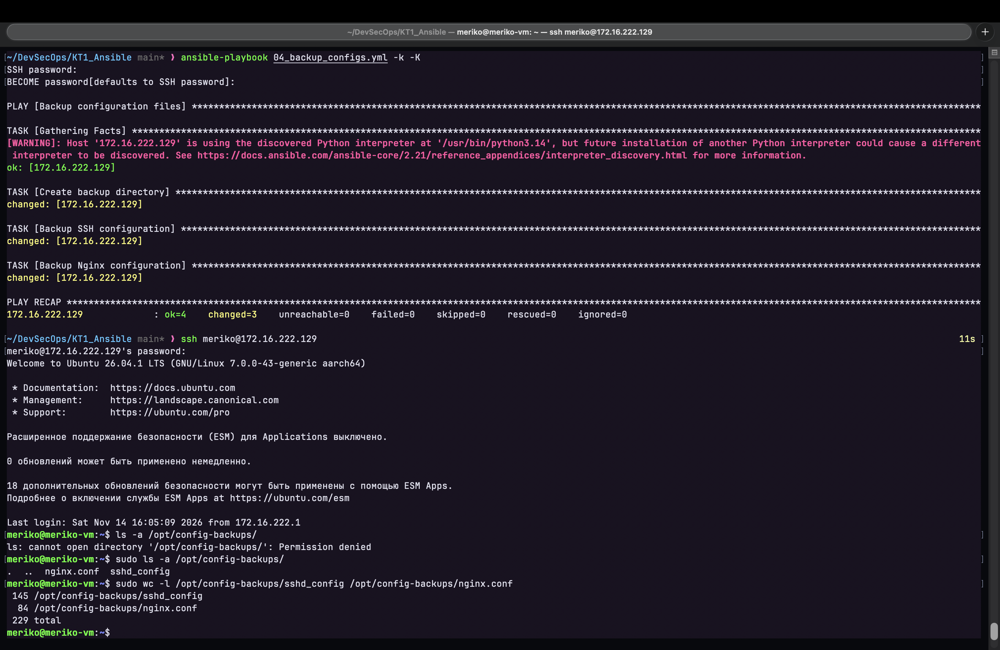
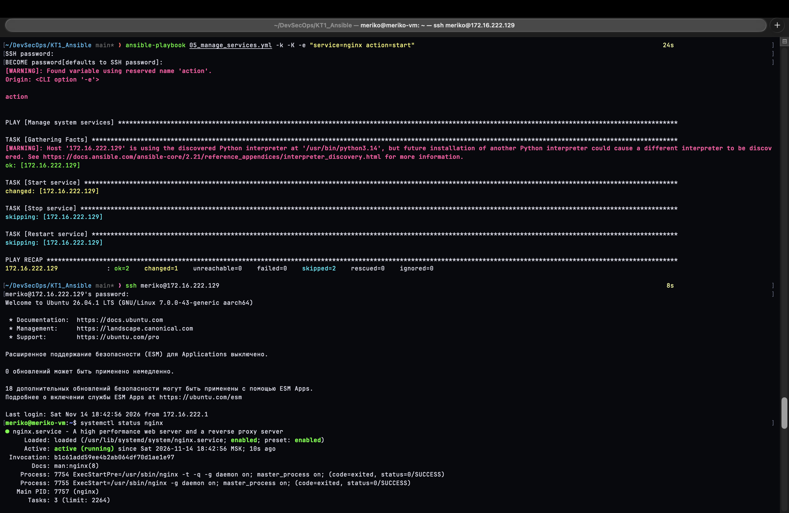
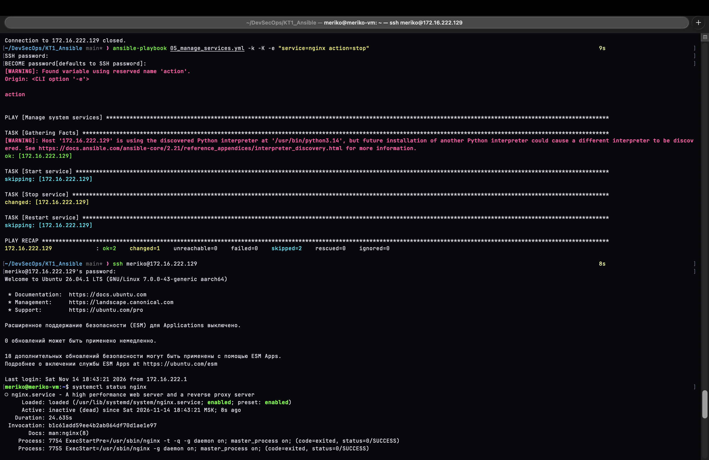
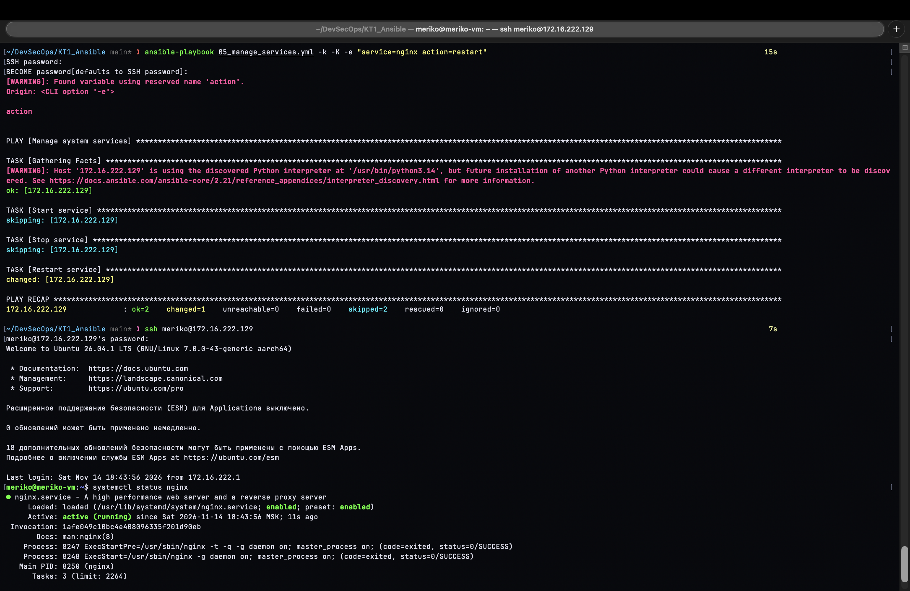

# КТ-1. Ansible Playbooks

## 1. Установка и настройка Nginx

**Файл:** `01_nginx_install.yml`

**Роль:** `roles/nginx/tasks/main.yml`

**Переменные:** `group_vars/NGINX`

### Назначение

Автоматическая установка веб-сервера Nginx на целевой сервер с помощью Ansible.

### Выполненные действия

1. Установка пакета Nginx с помощью модуля `apt`.
2. Запуск службы Nginx с помощью модуля `service`.
3. Включение автоматического запуска Nginx при загрузке системы.

### Запуск

```bash
ansible-playbook 01_nginx_install.yml
```

### Проверка

Проверка состояния службы:

```bash
systemctl status nginx
```

Проверка HTTP-ответа:

```bash
curl -I http://localhost
```


### Результат

Nginx успешно установлен, запущен и добавлен в автозагрузку. Проверка HTTP-запросом вернула `HTTP/1.1 200 OK`.


## 2. Создание пользователя и назначение прав

**Файл:** `02_cm_user.yml`

### Назначение

Автоматическое создание пользователя `newadmin` на целевом сервере и предоставление ему административных прав.

### Выполненные действия

1. Создание пользователя `newadmin` с помощью модуля `user`.
2. Добавление пользователя в группы `root` и `sudo`.
3. Сохранение существующих дополнительных групп с помощью параметра `append`.
4. Установка пароля с использованием хеширования SHA-512.

### Запуск

```bash
ansible-playbook 02_cm_user.yml
```

### Проверка

Подключение к серверу:

```bash
ssh newadmin@172.16.222.129
```

Проверка имени пользователя:

```bash
whoami
```

Проверка групп:

```bash
groups
```

Проверка административных прав:

```bash
sudo whoami
```


### Результат

Пользователь `newadmin` успешно создан. Подключение по SSH работает, пользователь входит в группы `root` и `sudo`. Выполнение команды `sudo whoami` возвращает `root`, что подтверждает наличие административных прав.


## Задание 3. Обновление пакетов и перезагрузка сервера

### Цель
Разработать Ansible Playbook для обновления установленных пакетов на целевом сервере и последующей перезагрузки системы.

### Реализация
Создан Playbook `03_update_reboot.yml`.

Используемые модули:
- `ansible.builtin.apt` — обновление списка пакетов и установка доступных обновлений.
- `ansible.builtin.reboot` — перезагрузка сервера и ожидание его доступности.

### Запуск

Проверка синтаксиса:

```bash
ansible-playbook 03_update_reboot.yml --syntax-check
```

Запуск:

```bash
ansible-playbook 03_update_reboot.yml -k -K
```

### Результат выполнения

Playbook успешно обновил пакеты и перезагрузил целевой сервер.

Итог выполнения:

- `ok=3`
- `changed=1`
- `unreachable=0`
- `failed=0`

### Проверка результата

Проверка времени последней загрузки:

```bash
uptime -s
```


Результат: `2026-11-14 15:16:45`.

После перезагрузки SSH-подключение к серверу восстановилось.

### Вывод
Обновление пакетов и перезагрузка целевого сервера успешно автоматизированы с помощью Ansible. Работоспособность сервера после перезагрузки подтверждена повторным SSH-подключением.


## Задание 4. Резервное копирование конфигурационных файлов

### Цель
Создать Ansible Playbook для резервного копирования определённых конфигурационных файлов на целевом сервере.

### Реализация

Создан Playbook `04_backup_configs.yml`, который позволяет выбирать файлы и директории для резервного копирования непосредственно при запуске, без изменения самого Playbook.

Используемые модули:
- `ansible.builtin.file` — создание директории для резервных копий и настройка прав доступа.
- `ansible.builtin.copy` — копирование файлов и директорий.
- `loop` — последовательная обработка всех элементов переданного списка.

Параметры:
- `backup_dir` — директория для хранения резервных копий (`/opt/config-backups`).
- `backup_paths` — список исходных файлов и директорий, передаваемый при запуске.

Для резервных копий настроены владелец и группа `root`, права доступа `0700`.

Параметр `remote_src: true` указывает, что исходные файлы находятся на целевом сервере.

### Проверка синтаксиса

```bash
ansible-playbook 04_backup_configs.yml --syntax-check
```

### Запуск Playbook

```bash
ansible-playbook 04_backup_configs.yml -k -K \
-e '{"backup_paths":["/etc/ssh/sshd_config","/etc/nginx/nginx.conf"]}'
```

В ходе выполнения были созданы резервные копии:
- `/etc/ssh/sshd_config`
- `/etc/nginx/nginx.conf`

### Результат выполнения

```text
ok=3
changed=0
unreachable=0
failed=0
```

Playbook выполнен успешно. `changed=0` означает, что на момент повторного запуска резервные копии уже существовали и соответствовали исходным файлам.

### Проверка резервных копий

Просмотр содержимого директории:

```bash
sudo ls -lah /opt/config-backups/
```

Проверка количества строк в файлах:

```bash
sudo wc -l /opt/config-backups/sshd_config /opt/config-backups/nginx.conf
```


Результат:

```text
145 /opt/config-backups/sshd_config
84 /opt/config-backups/nginx.conf
229 total
```

Оба файла успешно скопированы и содержат данные.

Доступ к директории ограничен пользователем `root`, поэтому для проверки используется `sudo`


### Сценарий 5. Управление системными службами

**Цель:** разработать Ansible Playbook для управления системными службами на удалённом сервере: запуск, остановка и перезапуск.

Создан Playbook `05_manage_services.yml`, использующий модуль `ansible.builtin.systemd_service` для управления службами через systemd.

Название службы и выполняемая операция передаются при запуске Playbook через дополнительные переменные:

- `service` — название службы;
- `operation` — выполняемая операция (`start`, `stop` или `restart`).

В Playbook реализованы три задачи с условием `when`. В зависимости от переданного значения выполняется только соответствующая задача.

**1. Запуск службы**

Команда запуска:

```bash
ansible-playbook 05_manage_services.yml -k -K -e "service=nginx operation=start"
```



**2. Остановка службы**

Команда остановки:

```bash
ansible-playbook 05_manage_services.yml -k -K -e "service=nginx operation=stop"
```



**3. Перезапуск службы**

Команда перезапуска:

```bash
ansible-playbook 05_manage_services.yml -k -K -e "service=nginx operation=restart"
```



**Проверка выполнения**

После каждой операции состояние службы проверялось непосредственно на целевом Ubuntu-сервере с помощью команды:

```bash
systemctl status nginx
```

Получены следующие результаты:

- После запуска: `active (running)` — служба работает.
- После остановки: `inactive (dead)` — служба остановлена.
- После перезапуска: `active (running)` — служба успешно запущена повторно.

Все три операции выполнены успешно. Ошибок выполнения Ansible Playbook не обнаружено (`failed=0`).
