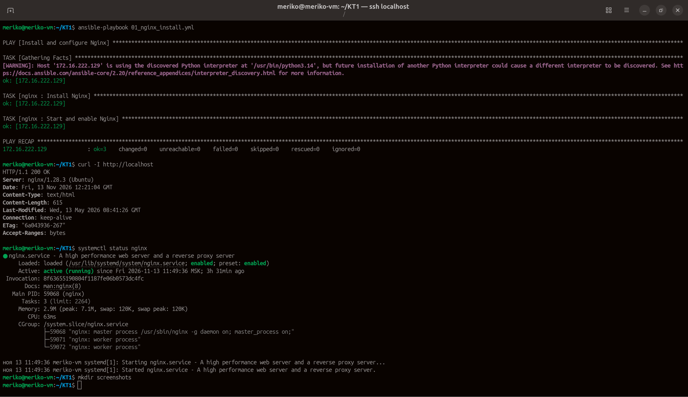

# КТ-1. Ansible Playbooks

## 1. Установка и настройка Nginx

**Файл:** `01_nginx_install.yml`

**Роль:** `roles/nginx/tasks/main.yml`

**Переменные:** `group_vars/NGINX`

### Назначение

Автоматическая установка веб-сервера Nginx на целевой сервер с помощью Ansible.

### Выполненные действия

1. Установка пакета Nginx с помощью модуля `apt`.
2. Запуск службы Nginx с помощью модуля `service`.
3. Включение автоматического запуска Nginx при загрузке системы.

### Запуск

```bash
ansible-playbook 01_nginx_install.yml
```

### Проверка

Проверка состояния службы:

```bash
systemctl status nginx
```

Проверка HTTP-ответа:

```bash
curl -I http://localhost
```


### Результат

Nginx успешно установлен, запущен и добавлен в автозагрузку. Проверка HTTP-запросом вернула `HTTP/1.1 200 OK`.
